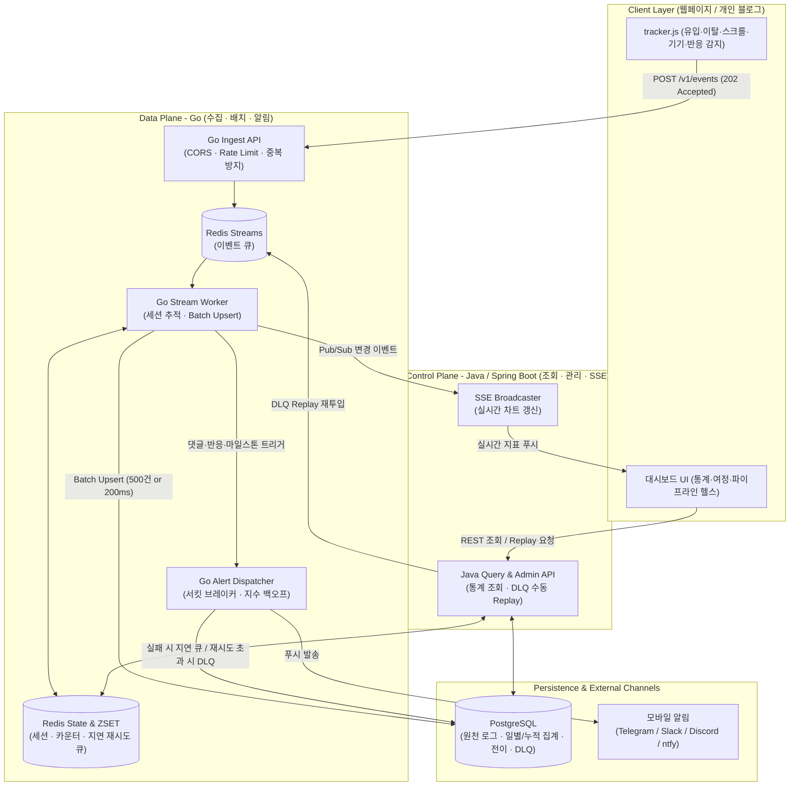
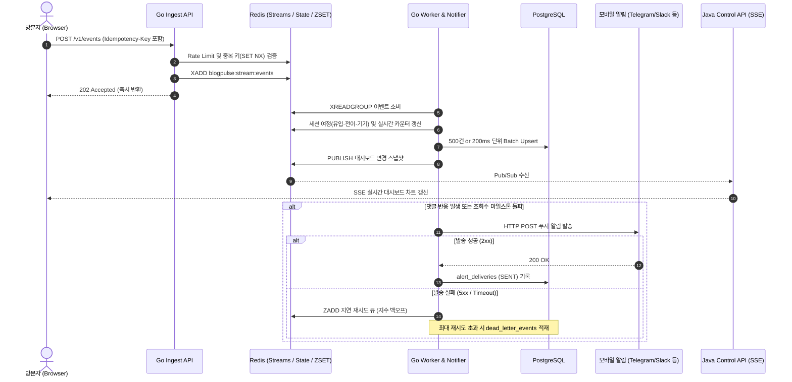
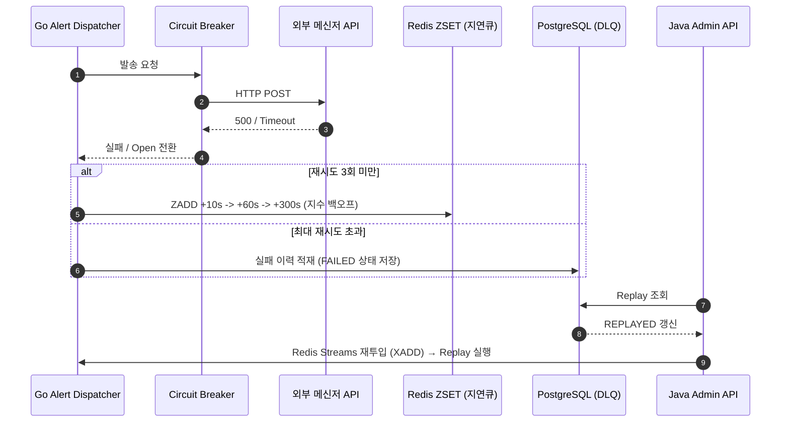

## 1. 아키텍처 개요 및 설계 결정

### 1.1 핵심 설계 결정 (ADR 요약)
1. **프론트엔드 단일 수집 경로 (`POST /v1/events`) 통일**
   * 외부 플랫폼 웹훅과 프론트엔드 수집기를 이중으로 운영하면 이벤트 스키마가 파편화되고 일반 웹페이지 확장이 어려워진다.
   * 브라우저 SDK(`tracker.js`)가 일반 페이지 이벤트와 임베드 위젯(`giscus` `postMessage` 메타데이터 변화 감지)을 모두 표준 JSON 이벤트로 정규화해 단일 엔드포인트로 전송한다.
2. **Data Plane(Go)과 Control Plane(Java) 역할 분리**
   * **Go (Data Plane):** 고빈도 트래픽 수용(`202 Accepted`), 고루틴·채널 버퍼 기반 PostgreSQL Batch Upsert, 서킷 브레이커 및 지수 백오프 기반 외부 알림 워커를 담당한다.
   * **Java / Spring Boot (Control Plane):** 복합 조건 통계 조회, 페이지 간 이동 흐름 집계, SSE 실시간 대시보드 스트리밍, DLQ 실패 이력 조회 및 수동 Replay 관리를 담당한다.
3. **경량 단일 노드 인프라**
   * 관리형 클라우드 DB/캐시 비용을 배제하고, 단일 VM(또는 로컬) 위에서 Docker Compose로 PostgreSQL, Redis, Go, Java 서비스를 일괄 운영한다.

판단 배경은 [[ADR] BlogPulse 아키텍처 결정 기록](/backstage/project/blogpulse/4120003/)에 따로 정리했다.

---

## 2. 전체 시스템 아키텍처 도식

---

## 3. 기술 스택 및 컴포넌트 책임

| 계층 | 기술 스택 | 세부 책임 |
| :--- | :--- | :--- |
| **Client SDK** | TypeScript (Vanilla) | `visibilitychange` + `sendBeacon` 이탈 추적, 뷰포트/UA 기반 `device_type`(`mobile`/`desktop`) 판별, `giscus` `postMessage` 델타 감지 |
| **Ingest & Worker** | Go, `net/http`, Redis Streams | CORS 검증, Sliding Window Rate Limit, `Idempotency-Key` 중복 차단, Consumer Group 소비, 채널 버퍼 Batch Upsert |
| **Alert Dispatcher** | Go | 알림 조건(댓글·반응·조회수 마일스톤) 판별, 서킷 브레이커, Redis ZSET 지수 백오프 재시도, DLQ 적재 |
| **Query & Admin** | Java (Spring Boot) | 일별/누적 통계 및 Next-Read 전이 조회, Redis Pub/Sub 구독 기반 SSE 브로드캐스팅, DLQ 수동 Replay 재투입 |
| **Persistence & Queue** | PostgreSQL, Redis | 시계열 이벤트·집계·전이·DLQ 영속화(PG), 스트림 큐·세션 상태·쿨다운·지연 재시도 큐(Redis) |

---

## 4. 핵심 처리 시퀀스 도식

### 4.1 이벤트 수집 · 배치 적재 · 실시간 SSE 반영 흐름

1. **비동기 즉시 응답:** `Go Ingest API`는 Redis `SET bp:idem:{key} 1 EX 86400 NX`로 중복 요청을 걸러낸 뒤 스트림에 적재하고 `202 Accepted`를 즉시 반환한다.
2. **조회수 쿨다운:** `visitor_hash + slug` 조합에 `SET bp:view:{visitor}:{slug} 1 EX 1800 NX`를 적용해 30분 내 새로고침 중복 집계를 방지한다.
3. **세션 여정 및 전이 추적:** Redis Hash(`bp:session:{session_id}`, `TTL 30분`)에서 `last_slug != current_slug`일 때 `from_slug -> to_slug` 전이 카운트를 누적한다.
4. **채널 버퍼 Batch Upsert:** 메모리 채널에 이벤트를 모았다가 **500건 도달 또는 200ms 경과** 시 PostgreSQL에 일괄 Upsert 한다.

---

### 4.2 모바일 알림 발송 · 장애 격리 · DLQ 수동 Replay 흐름

1. **마일스톤 중복 방지:** 누적 조회수가 `100`, `500`, `1000` 등 임계치를 최초 돌파할 때 `SET bp:milestone:{slug}:{threshold} 1 NX`로 1회만 알림을 생성한다.
2. **서킷 브레이커 & 지수 백오프:** 외부 웹훅 장애 시 서킷 브레이커가 불필요한 대기를 차단하고, Redis ZSET(`bp:retry:alerts`)에 다음 실행 시각(`+10s -> +60s -> +300s`)을 Score로 등록해 재시도한다.
3. **DLQ 및 원클릭 Replay:** 3회 재시도 초과 건은 `dead_letter_events` 테이블에 실패 원인과 함께 격리되며, 운영자가 대시보드에서 Replay 버튼을 누르면 `Java Admin API`가 스트림에 재투입한다.

---

## 5. 검증 및 테스트 기준

1. **기능 및 실환경 검증:** 실제 웹페이지에 `tracker.js`를 배포하여 기기 구분(`mobile`/`desktop`), 유입/이탈/전이 집계, 댓글·좋아요 발생 시 모바일 푸시 알림 및 대시보드 SSE 실시간 반영을 검증한다.
2. **부하 테스트 (`k6`):** 스파이크 트래픽 시나리오(500 VU 동시 유입)에서 단건 DB Insert 대비 채널 버퍼 Batch Upsert의 처리량(RPS) 및 p99 지연시간 개선 지표를 측정한다.
3. **장애 복구 시연:** 외부 알림 웹훅 엔드포인트에 500 에러 및 타임아웃을 주입해 서킷 브레이커 동작 → 지수 백오프 재시도 → DLQ 적재 → 대시보드 Replay 복구 전 과정을 검증한다.
