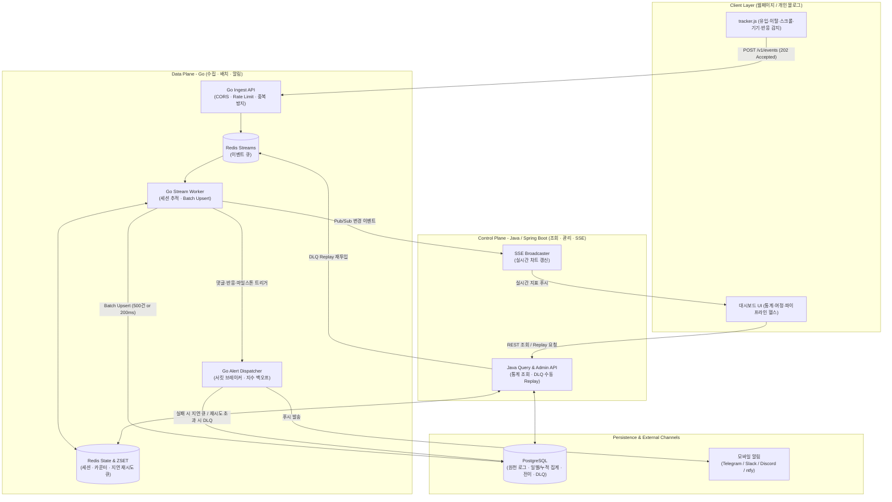
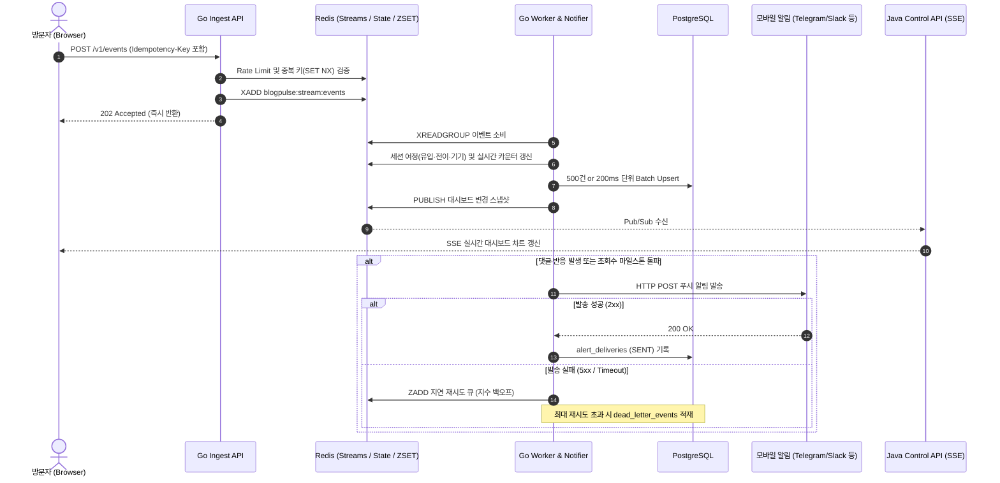
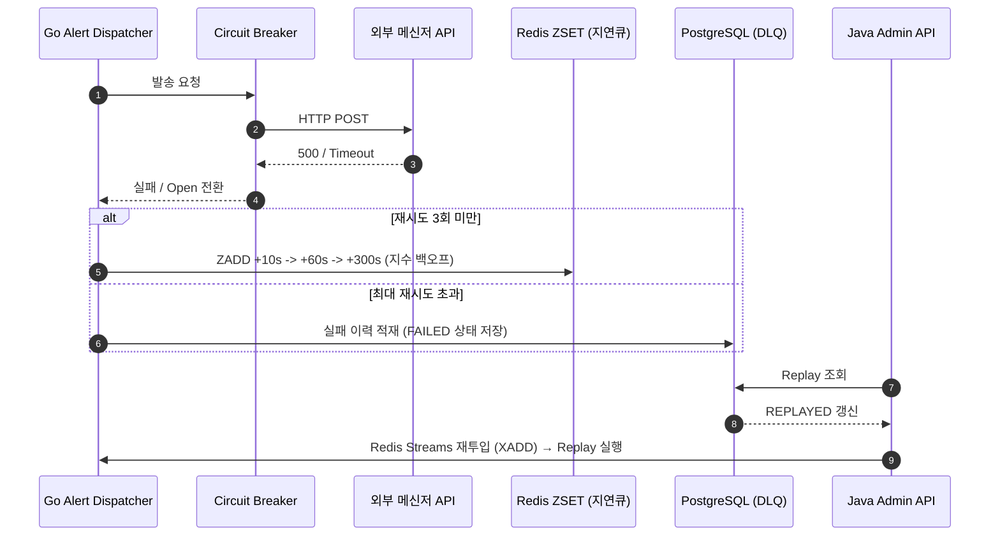
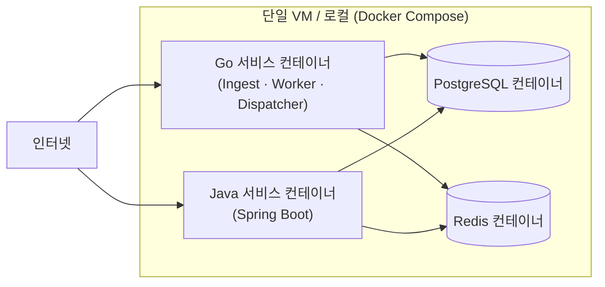

[기획 글](/backstage/project/blogpulse/4120001/)에서 정한 요구사항을 바탕으로, BlogPulse의 아키텍처를 [arc42](https://arc42.org) 템플릿의 12개 장 구조로 정리한다.

---

## 1. 소개 및 목표 (Introduction and Goals)

### 요구사항 개요

| 요구사항 | 구현 방식 |
| :--- | :--- |
| 어떤 웹페이지든 스크립트 한 줄로 연동 가능해야 한다 | `tracker.js` 단일 SDK + `POST /v1/events` 단일 엔드포인트로 수집 경로 통일 ([ADR-001](#9-아키텍처-결정-architecture-decisions)) |
| 조회·이탈·외부링크 클릭·좋아요·댓글을 수집해야 한다 | 모든 이벤트를 표준 JSON 스키마로 정규화해 단일 엔드포인트로 전송 |
| 댓글·좋아요·조회수 마일스톤 발생 시 모바일로 즉시 알려야 한다 | Go Alert Dispatcher + 서킷 브레이커/지수 백오프 + Telegram/Slack/Discord/ntfy 웹훅 |
| 방문자 지표를 실시간으로 확인할 수 있어야 한다 | Redis Pub/Sub → Java SSE Broadcaster → 대시보드 실시간 갱신 |
| 알림 발송 실패 건을 원인 확인 후 재처리할 수 있어야 한다 | PostgreSQL DLQ(`dead_letter_events`) + Java Admin API 수동 Replay |
| 3주 안에 수집~분석~알림~대시보드까지 구현해야 한다 | Data Plane/Control Plane 분리와 경량 단일 노드 인프라로 범위를 제어 |

### 품질 목표

| 우선순위 | 품질 목표 (ISO 25010) | 시나리오 | 구현 |
| :--- | :--- | :--- | :--- |
| 1 | 성능 효율성 (Performance Efficiency) | 인기 글이 공유되어 500 VU급 동시 유입이 발생해도 수집 API는 즉시 `202 Accepted`를 반환한다 | Redis Streams 비동기 적재 + 채널 버퍼 Batch Upsert(500건 또는 200ms) |
| 2 | 신뢰성 (Reliability / Fault Tolerance & Recoverability) | 외부 메신저 웹훅이 다운되어도 수집·집계 파이프라인은 영향받지 않고, 실패한 알림은 유실 없이 재처리된다 | 서킷 브레이커 + ZSET 지수 백오프 + DLQ 수동 Replay |
| 3 | 유지보수성 (Maintainability / Modifiability) | 수집·배치 로직(Go)과 조회·관리 로직(Java)을 서로 건드리지 않고 각각 변경할 수 있다 | Data Plane/Control Plane 물리적 분리 |

부차적으로는 **운영 비용 최소화**(관리형 클라우드 DB/캐시 대신 단일 VM + Docker Compose)도 목표로 두었다 — 1인 사이드 프로젝트라는 조건에서 비롯된 목표다.

### 이해관계자

이 프로젝트는 1인 개발 프로젝트라 기획·구현·배포·운영을 모두 같은 사람이 겸한다. 블로그·웹페이지 **방문자**는 직접적인 의사결정 주체는 아니지만 `tracker.js`를 통해 수집 대상이 되는 간접 이해관계자다. **모바일 알림 수신자**는 운영자 본인과 동일인으로, Telegram/Slack/Discord/ntfy 중 선택한 채널 하나로 실시간 피드백(새 댓글·좋아요·마일스톤)을 받는다. **giscus 같은 외부 임베드 위젯 운영 주체**는 시스템이 직접 제어할 수 없는 플랫폼이라, 그쪽 보안 정책(Cross-Origin iframe)이 수집 가능한 데이터의 범위를 제한하는 제약으로 작용한다.

---

## 2. 아키텍처 제약사항 (Architecture Constraints)

| 제약 종류 | 내용 |
| :--- | :--- |
| 인프라·비용 | 관리형 클라우드 DB/캐시를 쓰지 않고 단일 VM(또는 로컬)에서 Docker Compose로 PostgreSQL·Redis·Go·Java를 전부 구동해야 한다 |
| 일정 | 3주 안에 수집 파이프라인부터 여정 분석·알림·대시보드까지 전 기능을 구현해야 한다 |
| 외부 플랫폼 | giscus 같은 임베드 위젯은 Cross-Origin iframe 보안 정책 때문에 댓글 본문·작성자 ID를 직접 읽을 수 없고, `postMessage`로 전달되는 건수 변화(delta)만 수집할 수 있다 |
| 조직 | 1인 개발 프로젝트로, 코드 리뷰·운영 인수인계 같은 다인 조직의 프로세스는 적용되지 않는다 |

---

## 3. 시스템 범위와 컨텍스트 (Context and Scope)

### 비즈니스 컨텍스트

| 외부 파트너 | 시스템으로 들어오는 것 | 시스템에서 나가는 것 |
| :--- | :--- | :--- |
| 방문자 브라우저 (`tracker.js` 탑재) | `page_view` / `page_leave` / `outbound_click` / `reaction_created` / `comment_created` 표준 이벤트 | `202 Accepted` 즉시 응답 |
| giscus 임베드 위젯 | `postMessage` 메타데이터(댓글·반응 건수 변화) | 없음 (단방향 감지) |
| 모바일 메신저 (Telegram / Slack / Discord / ntfy 중 택1) | 발송 결과(2xx 성공, 5xx/Timeout 실패) | HTTP POST 푸시 알림 요청 |
| 운영자 (대시보드 UI) | REST 조회 요청, DLQ Replay 요청 | 통계·여정·파이프라인 헬스 응답, SSE 실시간 갱신 |

### 기술 컨텍스트

- 수집 경로: HTTPS `POST /v1/events` 단일 엔드포인트, `Idempotency-Key` 헤더로 중복 요청 식별
- 실시간 갱신 경로: Server-Sent Events(SSE)
- 알림 발송 경로: 각 메신저 플랫폼의 Incoming Webhook HTTP API
- 영속 저장: PostgreSQL(원천 로그·집계·DLQ), Redis(큐·세션·카운터·재시도 큐)

---

## 4. 솔루션 전략 (Solution Strategy)

- **기술 선택:** 두 경로가 요구하는 런타임 특성이 서로 다르다는 데서 출발한다. 수집 경로는 초당 수천 건의 짧은 I/O 바운드 요청을 동시에 처리해야 해서 요청당 메모리 오버헤드가 작고 가벼운 동시성 모델이 유리한 반면, 조회·관리 경로는 복합 조건 집계 쿼리·SSE 연결 관리·DLQ 상태 관리처럼 비즈니스 로직 밀도가 높아 성숙한 ORM·스케줄링·관리 도구 생태계가 개발 속도를 좌우한다. 그래서 Go의 가벼운 고루틴 동시성 모델(요청당 수 KB 스택)은 고동시성 수집·배치 적재·알림 디스패치(Data Plane)에, Java/Spring Boot의 성숙한 쿼리·SSE·관리 도구 생태계(Spring Data JPA, SSE Emitter 등)는 복합 조회·DLQ 관리(Control Plane)에 배치한다. 메시지 큐·세션·재시도 큐는 전부 Redis 하나로 통합하고, 영속 저장은 PostgreSQL 하나로 모은다.
- **최상위 분해 전략:** "쓰기 경로(고빈도, 지연에 민감)"와 "읽기·관리 경로(복잡한 쿼리, 상대적으로 저빈도)"를 Data Plane/Control Plane으로 물리적으로 분리해, 한쪽의 부하나 장애가 다른 쪽으로 전파되지 않게 한다.
- **품질 목표 달성 전략:**
  - *성능:* 수집 API는 Redis Streams에 적재 후 즉시 응답하는 비동기 패턴을 쓰고, 채널 버퍼 Batch Upsert로 DB 쓰기 비용을 분산한다.
  - *신뢰성:* 알림 발송 경로에 서킷 브레이커 + 지수 백오프 + DLQ 수동 Replay를 둬서 장애를 격리한다.
  - *유지보수성:* Go/Java 역할 분리로 한쪽을 고칠 때 다른 쪽의 변경 범위를 좁힌다.
- **조직적 결정:** 수집 SDK(`tracker.js`)는 외부 플랫폼 전용 어댑터 없이 표준 JSON 스키마 하나로 통일한다.

---

## 5. 빌딩 블록 뷰 (Building Block View)

### 전체 시스템 (Whitebox)

### 블랙박스 설명

| 빌딩 블록 | 책임 |
| :--- | :--- |
| `tracker.js` (Client SDK, TypeScript) | `visibilitychange`+`sendBeacon` 이탈 추적, 뷰포트/UA 기반 `device_type` 판별, `giscus` `postMessage` 델타 감지, 표준 JSON 이벤트 생성 |
| Go Ingest API | CORS 검증, Sliding Window Rate Limit, `Idempotency-Key` 중복 차단, Redis Streams 적재, `202` 즉시 응답 |
| Go Stream Worker | Consumer Group 소비, 세션 여정/전이/기기별 카운터 갱신, 채널 버퍼 Batch Upsert, Pub/Sub 변경 이벤트 발행 |
| Go Alert Dispatcher | 알림 조건(댓글·반응·마일스톤) 판별, 서킷 브레이커, ZSET 지수 백오프 재시도, DLQ 적재 |
| Java Query & Admin API | 일별/누적 통계 및 Next-Read 전이 조회, DLQ 실패 이력 조회 및 수동 Replay 재투입 |
| SSE Broadcaster (Java) | Redis Pub/Sub 구독 → 대시보드로 실시간 차트 갱신 푸시 |
| Redis Streams | 이벤트 큐(`blogpulse:stream:events`) |
| Redis State & ZSET | 세션 해시, 조회수/마일스톤 쿨다운 키, 지연 재시도 큐(`bp:retry:alerts`) |
| PostgreSQL | 원천 로그, 일별/누적 집계, 전이(Next-Read), `alert_deliveries`, `dead_letter_events` |
| 대시보드 UI | 통계·여정·파이프라인 헬스 뷰, Replay 트리거 |

---

## 6. 런타임 뷰 (Runtime View)

### 시나리오 1: 이벤트 수집 · 배치 적재 · 실시간 SSE 반영

1. **비동기 즉시 응답:** `Go Ingest API`는 Redis `SET bp:idem:{key} 1 EX 86400 NX`로 중복 요청을 걸러낸 뒤 스트림에 적재하고 `202 Accepted`를 즉시 반환한다.
2. **조회수 쿨다운:** `visitor_hash + slug` 조합에 `SET bp:view:{visitor}:{slug} 1 EX 1800 NX`를 적용해 30분 내 새로고침 중복 집계를 방지한다.
3. **세션 여정 및 전이 추적:** Redis Hash(`bp:session:{session_id}`, `TTL 30분`)에서 `last_slug != current_slug`일 때 `from_slug -> to_slug` 전이 카운트를 누적한다.
4. **채널 버퍼 Batch Upsert:** 메모리 채널에 이벤트를 모았다가 **500건 도달 또는 200ms 경과** 시 PostgreSQL에 일괄 Upsert 한다.

### 시나리오 2: 모바일 알림 발송 · 장애 격리 · DLQ 수동 Replay

1. **마일스톤 중복 방지:** 누적 조회수가 `100`, `500`, `1000` 등 임계치를 최초 돌파할 때 `SET bp:milestone:{slug}:{threshold} 1 NX`로 1회만 알림을 생성한다.
2. **서킷 브레이커 & 지수 백오프:** 외부 웹훅 장애 시 서킷 브레이커가 불필요한 대기를 차단하고, Redis ZSET(`bp:retry:alerts`)에 다음 실행 시각(`+10s -> +60s -> +300s`)을 Score로 등록해 재시도한다.
3. **DLQ 및 원클릭 Replay:** 3회 재시도 초과 건은 `dead_letter_events` 테이블에 실패 원인과 함께 격리되며, 운영자가 대시보드에서 Replay 버튼을 누르면 `Java Admin API`가 스트림에 재투입한다.

---

## 7. 배포 뷰 (Deployment View)

관리형 클라우드 DB/캐시 비용을 배제하고, 단일 VM(또는 로컬) 위에서 Docker Compose로 PostgreSQL·Redis·Go·Java 서비스를 일괄 운영한다. `tracker.js`는 별도 CDN 없이 정적 자산으로 각 웹페이지에 직접 삽입한다.

---

## 8. 횡단 관심사 (Crosscutting Concepts)

| 개념 | 내용 |
| :--- | :--- |
| 멱등성(Idempotency) | `SET bp:idem:{key} 1 EX 86400 NX`로 같은 요청의 중복 처리를 차단 |
| 조회수 쿨다운 | `SET bp:view:{visitor}:{slug} 1 EX 1800 NX`로 30분 내 재조회 중복 집계 방지 |
| 세션 추적 | Redis Hash `bp:session:{session_id}` (TTL 30분)로 유입·전이·기기 정보 유지 |
| 마일스톤 중복 방지 | `SET bp:milestone:{slug}:{threshold} 1 NX`로 임계치 돌파 알림을 1회만 생성 |
| 서킷 브레이커 + 지수 백오프 | `bp:retry:alerts` ZSET에 `+10s → +60s → +300s` Score로 재시도 일정 등록 |
| 배치 처리 | 채널 버퍼에 이벤트를 모아 500건 또는 200ms 중 먼저 찬 조건에 Batch Upsert |
| Graceful Shutdown | `SIGTERM` 수신 시 채널 버퍼 잔여 데이터를 DB에 커밋한 뒤 `XACK` |
| 보안 | CORS 검증, Sliding Window Rate Limit |
| 가시성/관측 | 초당 수집 요청 수, 봇/중복 차단 건수, 알림 성공/실패 현황, DLQ 상태(`FAILED`/`REPLAYED`) |

---

## 9. 아키텍처 결정 (Architecture Decisions)

### ADR-001: 프론트엔드 단일 수집 경로(`POST /v1/events`)로 이벤트 파이프라인 통일

- **상태:** 승인됨 (Accepted)
- **맥락:** 개인 블로그뿐 아니라 일반 웹페이지에서도 범용적으로 쓸 수 있는 이벤트 수집 파이프라인이 필요하다. 초기에는 깃 블로그의 댓글·반응 위젯(`giscus`)을 위해 GitHub Webhook 수신기와 GraphQL API 조회를 백엔드에 별도로 구축하는 방안을 검토했으나, 프론트엔드 수집기(`tracker.js`)와 수집 경로가 이원화되어 이벤트 스키마가 파편화되고 외부 플랫폼 의존성이 커지는 문제가 있었다.
- **결정:** 백엔드 이벤트 수집 진입점을 `POST /v1/events` 단일 엔드포인트로 통일한다. 페이지 조회·이탈·스크롤·기기 구분뿐 아니라, 임베드 위젯(`giscus`의 `data-emit-metadata="1"` 기반 `postMessage` 카운트 증가분)이나 일반 웹페이지의 버튼 반응 이벤트까지 모두 프론트엔드(`tracker.js`)에서 표준 JSON 페이로드로 정규화해 전송한다.
- **결과 (장단점):**
  - *장점:* 백엔드 수집·중복 제거·배치 적재·알림 파이프라인이 100% 단일화되어 구현·유지보수 복잡도가 크게 줄어든다. `tracker.js` 스크립트 삽입만으로 블로그와 일반 웹사이트 어디든 동일한 구조로 확장할 수 있다.
  - *단점:* 외부 임베드 위젯(`giscus`)의 Cross-Origin iframe 보안 정책상 댓글 본문 원문이나 작성자 ID는 프론트엔드에서 직접 읽을 수 없으며, 건수 변화(`delta`)만 수집할 수 있다. 브라우저에서 직접 요청이 들어오므로 클라이언트 위변조를 막기 위한 Rate Limiter 및 `Idempotency-Key` 검증이 필수적이다.
- **검토한 대안과 기각 이유:**
  - GitHub Webhook 수신기 + 프론트 수집 병행 — 수집 어댑터와 서명 검증 로직이 중복되며, 일반 웹페이지에서는 쓰이지 않을 기능에 리소스가 낭비되어 기각.
  - 프론트 수집 후 알림 시점에만 GitHub GraphQL API 조회 — 댓글 본문까지 알림에 담을 수 있으나, 외부 API 토큰 관리와 장애 포인트가 추가되고 본문 조회가 필수 요구사항이 아니라 기각.
- **결정 준수 여부 검증:** `Go Ingest API` 라우터에 외부 플랫폼 전용 웹훅 엔드포인트가 존재하지 않고 `POST /v1/events` 단일 경로로 모든 이벤트 타입이 유입되는지 확인한다. 실제 웹페이지와 `giscus` 위젯 환경에서 `tracker.js`가 동일한 스키마로 이벤트를 발행하는지 통합 테스트로 검증한다.

### ADR-002: Data Plane(Go)과 Control Plane(Java / Spring Boot) 역할 분리

- **상태:** 승인됨 (Accepted)
- **맥락:** 고빈도 쓰기 경로(이벤트 수집)와 복합 조회·관리 경로는 요구되는 동시성 모델과 생태계가 다르다. 수집 경로는 초당 수천 건의 짧은 I/O 바운드 요청을 동시에 처리해야 해서 요청당 메모리 오버헤드가 작고 가벼운 동시성 모델이 유리한 반면, 조회·관리 경로는 복합 조건 집계 쿼리·SSE 연결 관리·DLQ 상태 관리처럼 비즈니스 로직 밀도가 높아 성숙한 ORM·스케줄링·관리 도구 생태계가 개발 속도를 좌우한다. 단일 모놀리식으로 구현하면 트래픽 급증 시 대시보드 조회 응답이 지연되거나, 반대로 무거운 통계 쿼리가 수집 워커의 자원을 점유할 위험도 있다.
- **결정:** Go의 가벼운 고루틴 동시성 모델(요청당 수 KB 스택)을 고동시성 이벤트 수집·Redis Streams 소비·Batch Upsert·알림 워커(Data Plane)에, Java/Spring Boot의 성숙한 쿼리·SSE·관리 도구 생태계(Spring Data JPA, SSE Emitter 등)를 통계/Next-Read 조회·SSE 브로드캐스팅·DLQ 조회/Replay(Control Plane)에 배치한다.
- **결과 (장단점):**
  - *장점:* 수집·처리 계층과 조회·관리 계층의 장애·부하가 격리되고, 각 계층이 자신에게 맞는 런타임 특성을 쓸 수 있다.
  - *단점:* 두 언어 런타임과 빌드 파이프라인을 함께 관리해야 하는 비용이 생긴다.
- **검토한 대안과 기각 이유:** Go 또는 Java 단일 스택 — 운영 단순성은 높지만, 고빈도 동시성과 복합 쿼리/관리 생태계라는 서로 반대 방향의 요구사항을 한 언어로 동시에 최적화하기 어려워 기각.
- **결정 준수 여부 검증:** Go 서비스는 PostgreSQL에 대한 Write(Batch Upsert·알림 이력 기록)만 수행하고 복잡한 대시보드 통계 Read 쿼리를 갖지 않으며, Java 서비스는 대시보드 조회 및 DLQ Replay 재투입(`XADD`)만 담당하는지 코드 리뷰로 점검한다.

### ADR-003: 비동기 스트림 큐(Redis Streams) 및 채널 버퍼 기반 PostgreSQL Batch Upsert 도입

- **상태:** 승인됨 (Accepted)
- **맥락:** 인기 글 공유 등으로 순간적인 트래픽 스파이크가 발생할 때 요청마다 PostgreSQL에 단건 `INSERT/UPDATE`를 동기 실행하면 DB 커넥션 풀 고갈과 디스크 I/O 병목이 발생해 수집 API 응답 시간이 급격히 저하된다. 또한 클라이언트의 `page_leave`(`sendBeacon`) 요청은 브라우저 종료 시점에 짧은 타임아웃으로 전송되므로 수집 API의 즉각적인 수신 응답이 중요하다.
- **결정:** `Go Ingest API`는 `Idempotency-Key`와 Rate Limit 검증 후 Redis Streams(`blogpulse:stream:events`)에 이벤트를 적재하고 즉시 `202 Accepted`를 반환한다. `Go Stream Worker`는 Consumer Group으로 메시지를 읽어 메모리 채널 버퍼에 모은 뒤, **500건 도달 또는 200ms 경과** 조건 중 먼저 충족되는 시점에 PostgreSQL로 일괄 Batch Upsert를 수행한다.
- **결과 (장단점):**
  - *장점:* 수집 API의 응답 지연이 Redis 메모리 쓰기 수준(수 ms)으로 고정되며, DB 커넥션 및 트랜잭션 오버헤드를 대폭 절감한다. DB 일시 부하 시 Redis Streams가 완충 버퍼(Backpressure) 역할을 수행한다.
  - *단점:* 완전 동기 방식 대비 DB 반영까지 최대 200ms의 준실시간 지연이 발생한다. 워커 프로세스가 비정상 종료될 경우 메모리 버퍼에 대기 중이던 최대 500건의 이벤트가 유실되지 않도록 `Graceful Shutdown` 플러시와 Redis Streams `XACK` 시점 제어가 필요하다.
- **검토한 대안과 기각 이유:**
  - 수집 API에서 PostgreSQL 동기 단건 Insert — 구현은 단순하나 동시 요청 증가 시 DB 락 경합과 레이턴시 급증이 불가피해 기각.
  - Apache Kafka 도입 — 단일 VM 환경에서 브로커/메모리 리소스 점유가 과도하여, 이미 세션·쿨다운·재시도 큐로 사용 중인 Redis의 Streams 기능으로 통합하는 편이 효율적이라 판단해 기각.
- **결정 준수 여부 검증:** `k6` 스파이크 부하 테스트(500 VU)를 통해 단건 동기 Insert 대비 Batch Upsert의 초당 처리량(RPS) 및 p99 지연시간 개선 수치를 측정해 검증한다(상세 측정 방법은 [QS-1](#10-품질-요구사항-quality-requirements) 참고). `SIGTERM` 종료 시그널 수신 시 채널 버퍼 잔여 데이터를 DB에 커밋한 뒤 `XACK`를 호출하는지는 [QS-5](#10-품질-요구사항-quality-requirements)에서 통합 테스트로 확인한다.

### ADR-004: 외부 알림 장애 격리를 위한 서킷 브레이커, 지수 백오프 및 DLQ 수동 Replay 구조

- **상태:** 승인됨 (Accepted)
- **맥락:** 모바일 푸시 알림 발송 대상인 외부 메신저 웹훅(Telegram, Slack, Discord, ntfy)은 네트워크 지연이나 일시적 `5xx` 장애가 발생할 수 있다. 외부 알림 실패가 이벤트 수집·집계 워커 전체를 블로킹하거나, 단순 무한 재시도로 워커 스레드를 고갈시켜서는 안 되며, 최종 실패한 알림도 유실 없이 복구할 수 있어야 한다.
- **결정:** 알림 발송 경로에 **서킷 브레이커**를 적용해 연속 실패 시 외부 호출을 즉시 차단(Fail-Fast)한다. 일시적 실패 건은 Redis ZSET 지연 재시도 큐(`bp:retry:alerts`)에 다음 실행 시각(`+10s -> +60s -> +300s`)을 Score로 등록해 지수 백오프 재시도를 수행한다. 최대 재시도(3회) 초과 시 PostgreSQL `dead_letter_events` 테이블에 실패 사유와 원본 페이로드를 저장하고, 운영자가 대시보드에서 클릭 한 번으로 스트림에 재투입(`REPLAYED`)할 수 있는 수동 Replay API를 제공한다.
- **결과 (장단점):**
  - *장점:* 외부 알림 채널 장애가 핵심 트래픽 수집·DB 집계 파이프라인으로 전파되는 것을 원천 차단한다. 일시적 네트워크 오류는 자동 복구되고, 장기 장애 건도 데이터 유실 없이 관측 및 재처리할 수 있다.
  - *단점:* 재시도 스케줄러(ZSET 폴링 워커)와 DLQ 테이블 상태 관리(`FAILED` / `REPLAYED`), 재투입 시 중복 알림 방지 로직을 추가로 구현해야 한다.
- **검토한 대안과 기각 이유:** HTTP 클라이언트 타임아웃만 설정하고 실패 시 로그만 남김 — 장애 격리는 가능하지만 일시적 오류에도 알림이 영구 유실되고 운영자가 실패 건을 재처리할 수 없어 기각.
- **결정 준수 여부 검증:** 알림 수신 목(Mock) 서버에 연속 500 에러 및 타임아웃을 주입해 `서킷 브레이커 Open -> ZSET 지수 백오프 재시도 -> DLQ 적재 -> 대시보드 Replay 실행 후 정상 발송`까지의 전 과정을 E2E 테스트로 검증한다(상세 측정 방법은 [QS-3](#10-품질-요구사항-quality-requirements) 참고).

---

## 10. 품질 요구사항 (Quality Requirements)

| ID | 자극 (Stimulus) | 시스템 반응 | 측정 방법 |
| :--- | :--- | :--- | :--- |
| QS-1 | 인기 글 공유로 500 VU급 동시 유입 발생 | 채널 버퍼 Batch Upsert로 비동기 처리, 수집 API는 즉시 `202` 응답 | `k6` 부하 테스트로 단건 Insert 대비 처리량(RPS)·p99 지연시간 개선 지표 확인 |
| QS-2 | 새 댓글/좋아요 또는 조회수 마일스톤 발생 | 모바일 메신저로 지체 없이 푸시 알림 발송 | 실제 웹페이지 환경에서 댓글·좋아요 발생 시 알림 수신 및 대시보드 SSE 반영 확인 |
| QS-3 | 외부 메신저 웹훅에 연속 `500`/Timeout 발생 | 서킷 브레이커 Open → 지수 백오프 재시도 → 3회 초과 시 DLQ 적재, 수집 파이프라인은 영향 없음 | 장애 주입 E2E 테스트로 서킷 브레이커 → ZSET 재시도 → DLQ → Replay 전 과정 검증 |
| QS-4 | 같은 방문자가 30분 내 같은 글을 새로고침 | 조회수 중복 집계 없이 1회만 반영 | `SET NX` 쿨다운 키 적용 여부를 통합 테스트로 확인 |
| QS-5 | 워커 프로세스가 `SIGTERM`을 수신 | 채널 버퍼에 남아 있던 이벤트를 DB에 커밋한 뒤 `XACK` | 종료 시그널 주입 테스트로 버퍼 유실 없음을 확인 |
| QS-6 | 실제 웹페이지에 `tracker.js`를 배포한 뒤 다양한 기기로 접속 | 기기 구분(`mobile`/`desktop`), 유입·이탈·전이(Next-Read)가 정확히 집계됨 | 실환경 통합 테스트로 확인 |

---

## 11. 리스크와 기술 부채 (Risks and Technical Debt)

| 리스크/부채 | 내용 |
| :--- | :--- |
| 준실시간 지연 | Batch Upsert 특성상 완전 동기 방식 대비 DB 반영까지 최대 200ms 지연이 발생한다 (의도적으로 수용한 트레이드오프) |
| 워커 종료 시 이벤트 유실 가능성 | 메모리 채널 버퍼에 대기 중인 최대 500건이 Graceful Shutdown 로직의 구현 품질에 따라 유실될 수 있다 |
| giscus 댓글 본문 미수집 | Cross-Origin 제약으로 건수 변화(delta)만 수집 가능해, 알림에 댓글 본문이나 작성자 정보를 담을 수 없다 |
| 2개 언어 런타임 관리 비용 | Go/Java 런타임과 빌드 파이프라인을 함께 유지해야 하는 운영 부담이 생긴다 |
| DLQ 재투입 시 중복 알림 가능성 | Replay 시 이미 발송된 알림과 중복 발송을 막는 로직이 아직 상세 설계되지 않았다 |
| Redis Streams의 영속성·확장성 한계 | Kafka 대비 디스크 보존·파티셔닝 기능이 약해, 트래픽이 단일 VM 용량을 초과하면 메시징 계층 재설계가 필요할 수 있다 |
| 단일 노드 인프라의 단일 장애점(SPOF) | VM 자체가 다운되면 전체 서비스가 중단된다 — 운영 비용 최소화를 위해 의도적으로 수용한 리스크다 |

---

## 12. 용어사전 (Glossary)

| 용어 | 설명 |
| :--- | :--- |
| Idempotency-Key | 중복 요청을 식별해 같은 이벤트가 두 번 처리되지 않도록 막는 클라이언트 발급 키 |
| DLQ (Dead Letter Queue) | 재시도를 모두 소진한 실패 메시지를 격리 보관하는 저장소 (`dead_letter_events` 테이블) |
| SSE (Server-Sent Events) | 서버가 클라이언트로 단방향 실시간 스트림을 푸시하는 HTTP 기반 프로토콜 |
| 서킷 브레이커 (Circuit Breaker) | 연속 실패 시 외부 호출을 즉시 차단해 장애 전파를 막는 패턴 |
| Batch Upsert | 여러 건의 삽입/갱신을 모았다가 한 번에 실행하는 DB 쓰기 최적화 기법 |
| Consumer Group | Redis Streams에서 여러 소비자가 메시지를 분담해 읽도록 묶는 단위 |
| ZSET | Redis의 정렬 집합 자료구조. 여기서는 재시도 시각을 Score로 활용 |
| Next-Read Flow | 한 페이지를 읽은 방문자가 다음으로 가장 많이 이동한 페이지를 집계한 지표 |
| Replay | DLQ에 격리된 실패 이벤트를 운영자가 수동으로 다시 처리 큐에 투입하는 동작 |
